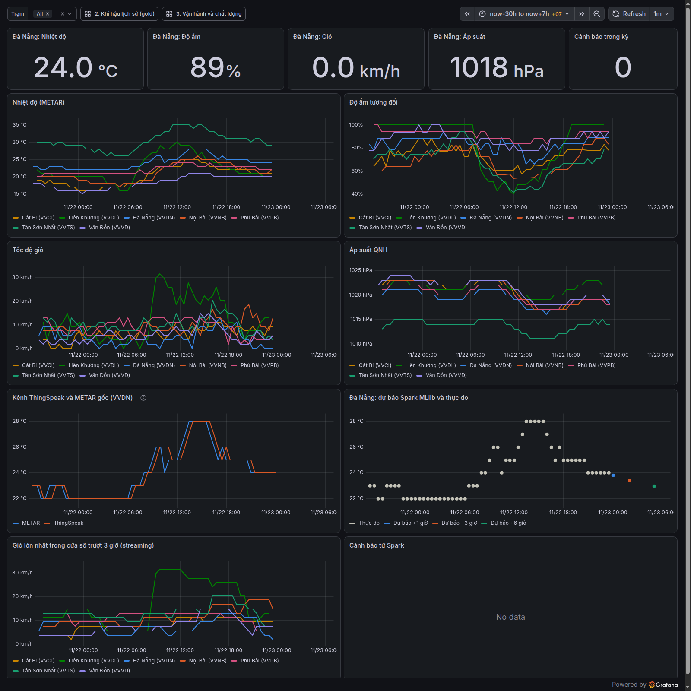
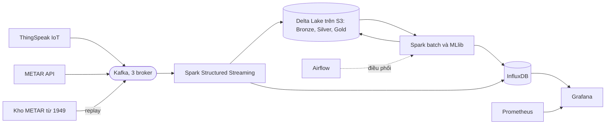
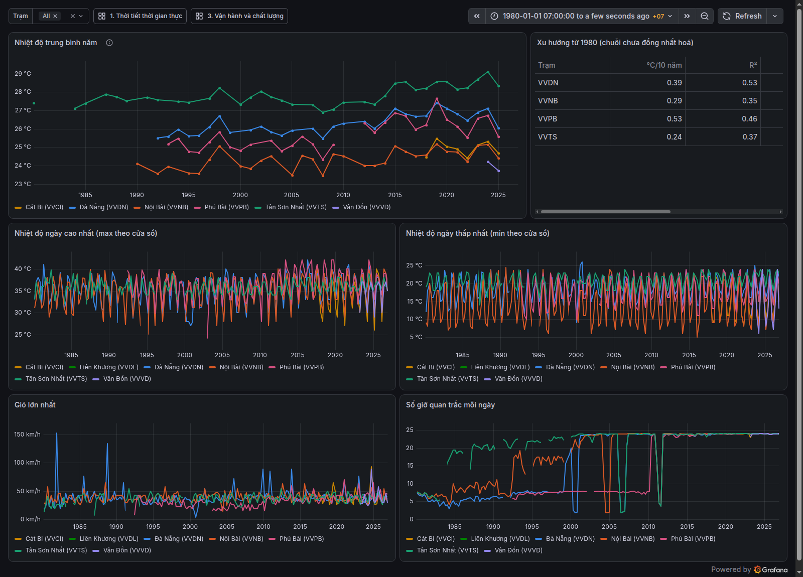
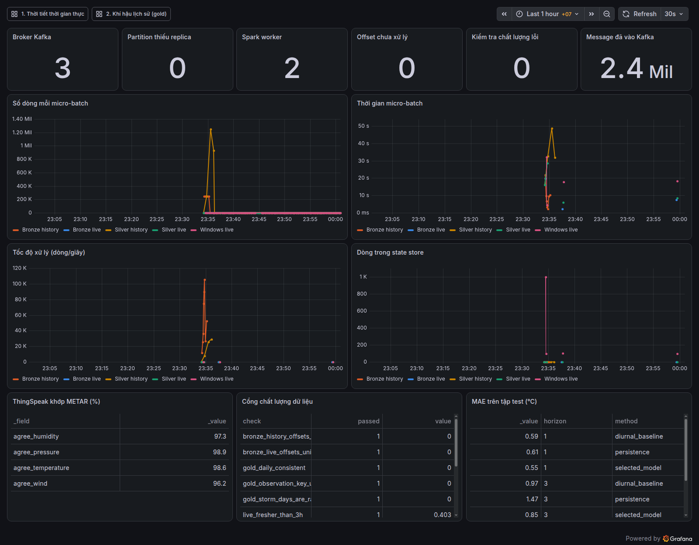

# Weather Big Data Pipeline

Đồ án môn **Kỹ thuật xử lý dữ liệu lớn**: pipeline streaming và batch cho dữ liệu thời tiết Việt Nam,
xuất phát từ kênh IoT công khai [ThingSpeak 3574112](https://thingspeak.mathworks.com/channels/3574112),
mở rộng bằng METAR live và 2,4 triệu quan trắc lịch sử từ năm 1949.



## Kiến trúc



| Tầng | Công nghệ | Vai trò |
|---|---|---|
| Nguồn | ThingSpeak, AviationWeather, IEM | API, IoT, dữ liệu lịch sử |
| Ingestion | Python, **Kafka 4.3** KRaft | 3 broker, RF=3, DLQ |
| Stream | **Spark 4.1** Structured Streaming | làm sạch, khử trùng, watermark, cửa sổ, alert |
| Lakehouse | **Delta Lake 4.4**, **SeaweedFS** (S3) | Bronze, Silver, Gold, ACID |
| Batch và ML | Spark SQL, **Spark MLlib** | khí hậu, QC, dự báo +1, +3, +6 giờ |
| Điều phối | **Airflow 3.3** | Gold hằng ngày, train hằng tuần, dự báo 30 phút/lần |
| Serving | **InfluxDB 2.9** | time-series cho dashboard |
| Trực quan | **Grafana 13** | 3 dashboard, 3 alert rule |
| Giám sát | **Prometheus**, kafka-exporter, Kafka UI | broker, worker, lag |

## Chạy

Yêu cầu: Linux, Docker và Compose v2, `make`, Python 3, khoảng 16 GB RAM trống và 20 GB đĩa.

```bash
make demo     # build, khởi động, tải lịch sử, backfill, gold, train, dự báo
make urls     # địa chỉ các giao diện, mật khẩu được sinh ngẫu nhiên trong .env
```

Lần đầu mất khoảng 30 phút tùy mạng, các lần sau khoảng 11 phút.

| Giao diện | Địa chỉ | Đăng nhập |
|---|---|---|
| Grafana | http://localhost:13000 | `admin` / `GRAFANA_PASSWORD` |
| Airflow | http://localhost:18083 | `admin` / `AIRFLOW_PASSWORD` |
| InfluxDB | http://localhost:18086 | `admin` / `INFLUX_PASSWORD` |
| Spark master | http://localhost:18081 | |
| Spark streaming | http://localhost:14040 | |
| Kafka UI | http://localhost:18082 | chỉ đọc |
| Prometheus | http://localhost:19090 | |

Tất cả chỉ bind `127.0.0.1`.

## Lệnh thường dùng

```bash
make help       # tất cả lệnh
make up         # khởi động lại, dữ liệu còn nguyên
make down       # dừng, không xóa dữ liệu
make status
make logs
make gold       # tính lại Gold
make check      # cổng chất lượng dữ liệu
make train      # huấn luyện lại
make test       # lint và unit test
make e2e        # tiêm lỗi: kill broker, driver, worker (khoảng 4 phút)
make bench      # benchmark (khoảng 26 phút, tạm dừng streaming)
```

Xóa sạch toàn bộ dữ liệu của dự án (không hoàn tác được): `docker compose --profile tools down -v`.

## Kết quả chính

- **2.428.936** bản ghi đi qua Kafka (34.000 msg/giây), đối soát độc lập không lệch.
- **Chịu lỗi:** kill broker, driver, worker khi đang chạy, 0 mất và 0 trùng ở Silver.
- **Mở rộng:** 48,5 triệu dòng, speedup 1,87 / 2,93 / 3,83 lần trên 2 / 4 / 8 core.
- **Lưu trữ:** Delta nhỏ hơn JSON khoảng 20 lần.
- **Dự báo +6 giờ:** MAE 1,10 °C, so với 1,35 °C của baseline và 2,51 °C của persistence.




## Tài liệu

- [Kiến trúc, lý do chọn công nghệ, đảm bảo khi lỗi](docs/ARCHITECTURE.md)
- [Dữ liệu và các vấn đề chất lượng đã phát hiện](docs/DATA.md)
- [Kết quả thực nghiệm](docs/RESULTS.md)
- [Kịch bản demo và câu hỏi bảo vệ](docs/DEMO.md)

## Cấu trúc

```text
src/weather_pipeline/
  ingest/       collector, archive, replay, tạo topic
  streaming/    luật Silver, cửa sổ và alert, sink, app
  batch/        Gold và cổng chất lượng
  ml/           feature, train, dự báo
  common/       cấu hình, Spark session, InfluxDB
  tools/        report, benchmark, e2e
dags/           Airflow
docker/         cấu hình InfluxDB, Prometheus, Grafana
scripts/        sinh dashboard, điều khiển benchmark và tiêm lỗi
tests/          unit test
docs/           tài liệu, số liệu, ảnh chụp
```

## Nguồn dữ liệu

- ThingSpeak channel 3574112 "Weather data CYD", tác giả simonhyde.
- NOAA/NWS Aviation Weather Center, Data API.
- Iowa Environmental Mesonet, Iowa State University, ASOS/METAR archive.

Dữ liệu tải về không được commit (`data/`).
