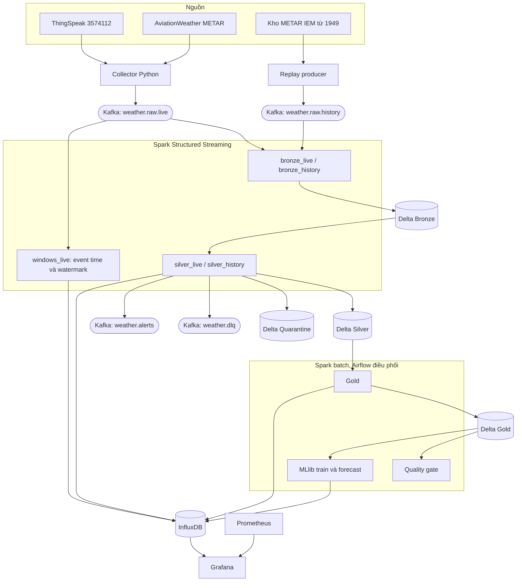

# Kiến trúc và quyết định thiết kế

## 1. Bài toán

Thu thập, làm sạch, lưu trữ, phân tích và dự báo dữ liệu thời tiết sân bay Việt Nam, gồm:

- **luồng live**: kênh IoT ThingSpeak 3574112 và METAR của 7 sân bay;
- **luồng lịch sử**: kho METAR công khai từ năm 1949, khoảng 2,4 triệu bản ghi.

Hai luồng phải dùng chung một bộ luật xử lý, chịu được lỗi và chạy lại không sinh trùng.

## 2. Luồng dữ liệu

Các bảng Delta nằm trên SeaweedFS, truy cập qua S3A.

Kiến trúc là **lai**: thu thập và làm sạch theo kiểu Kappa (lịch sử được phát lại qua Kafka, dùng
cùng code với live), còn Gold và huấn luyện mô hình là batch, vì cần đọc toàn bộ lịch sử và không
cần độ trễ giây.

## 3. Các tầng dữ liệu

| Tầng | Nội dung | Khóa | Phân vùng | Cách ghi |
|---|---|---|---|---|
| Bronze | message nguyên bản và tọa độ Kafka | topic, partition, offset | `ingest_date` | append, checkpoint |
| Silver | một schema, một hệ đơn vị, cờ QC | station, event_id | `station` | `MERGE` |
| Quarantine | bản ghi bị loại và lý do | topic, partition, offset | `reject_reason` | append với `txnAppId`, `txnVersion` |
| Gold | observations, hourly, daily, monthly, annual, trends, climatology, quality, reconciliation | tùy bảng | `station` (bảng lớn) | overwrite nguyên tử |
| Serving | InfluxDB: `weather_live` (90 ngày), `weather_analytics` (200 năm), `pipeline_metrics` (14 ngày) | measurement, tags, time | shard theo thời gian | ghi đè theo khóa |

## 4. Lựa chọn công nghệ

| Vai trò | Chọn | Lý do | Phương án không chọn |
|---|---|---|---|
| Message bus | Kafka KRaft, 3 broker | RF=3, min ISR=2, phát lại được | MQTT: hợp với thiết bị nhưng không có log để phát lại. 1 broker: không minh họa được chịu lỗi |
| Xử lý | Spark 4.1 | một engine cho stream, batch và ML | Flink: độ trễ thấp hơn, nhưng nguồn cập nhật 30 phút/lần và vẫn cần thêm engine cho ML |
| Table format | Delta Lake 4.4 | ACID, MERGE, đọc được như stream | Parquet thuần: không có MERGE và commit nguyên tử. Iceberg: tốt nhưng cần thêm catalog |
| Object storage | SeaweedFS | tương thích S3, nhẹ | MinIO: không còn image chính thức trên Docker Hub. HDFS: nặng trên một máy |
| Serving | InfluxDB 2.9 | chuỗi thời gian, Flux, tích hợp Grafana | InfluxDB 3 Core: thiết kế cho dữ liệu gần, không hợp truy vấn 70 năm. Cassandra: yếu về truy vấn tổng hợp |
| Trực quan | Grafana | cấu hình bằng file, có alert | Superset: mạnh về BI, kém về giám sát realtime |
| Điều phối | Airflow 3 | DAG, retry, lịch sử chạy | cron: không có phụ thuộc giữa các task |
| ML | Spark MLlib | huấn luyện phân tán ngay trên lakehouse | scikit-learn: phải kéo dữ liệu về một máy |
| Giám sát | Prometheus, kafka-exporter, StreamingQueryListener | thấy cả hạ tầng lẫn từng micro-batch | chỉ xem log |

## 5. Đảm bảo khi có lỗi

| Đoạn | Mức đảm bảo | Cơ chế |
|---|---|---|
| API → Kafka | at-least-once | chỉ ghi nhớ bản ghi sau khi được ack, đọc bù khi khởi động hoặc sau lỗi |
| Producer → broker | không trùng trong một phiên producer | idempotence, `acks=all` |
| Kafka → Bronze | exactly-once | checkpoint và transaction log của Delta |
| Bronze → Silver | effectively-once | `MERGE` theo event_id |
| Silver → Quarantine | exactly-once | transaction id theo query và batch |
| → DLQ, alerts | **at-least-once** | consumer cần khử trùng theo event_id hoặc offset |
| → InfluxDB | effectively-once | cùng tags và timestamp thì ghi đè. Gold xóa measurement trước khi publish lại. Live: field bị bỏ trong METAR đính chính vẫn giữ giá trị cũ |

Khi collector khởi động lại, nó gửi lại dữ liệu đọc bù. Bronze lưu các bản sao này (đúng vai trò log
thô), Silver hợp nhất chúng.

Chạy lại `make backfill` (hoặc `make demo`) trên stack đã có dữ liệu thì Bronze có thêm một bản sao
lịch sử, Silver không đổi.

Phép thử thực nghiệm: `make e2e`, kết quả ở [RESULTS.md](RESULTS.md).

## 6. Các khái niệm xử lý stream

- **Event time**: dùng giờ quan trắc, không dùng giờ đến Kafka.
- **Watermark 3 giờ**: giới hạn state. Dữ liệu muộn hơn bị bỏ khỏi cửa sổ trượt nhưng **vẫn vào Bronze và Silver**.
- **Cửa sổ trượt 3 giờ, bước 30 phút**: mọi phép tổng hợp đều bất biến với message trùng
  (min, max, `collect_set` thay cho `avg` và `count`).
- **State store RocksDB**, checkpoint trên S3.
- **Tách lane live và history** (topic, query, bảng riêng): backfill không chiếm chỗ dữ liệu live.
- **Một driver ghi cho mỗi bảng**: Delta trên S3 thường chỉ an toàn commit trong một driver. Streaming
  là writer duy nhất của Bronze, Silver, Quarantine. Không chạy `make gold` hoặc `make train` đúng lúc
  DAG tương ứng đang chạy.

## 7. Phân bổ tài nguyên

Cụm Spark có 2 worker, tổng 8 core và 8 GB:

- streaming giữ 4 core;
- job batch dùng tối đa 4 core, Airflow chạy tuần tự (`parallelism=1`);
- `make bench` tạm dừng streaming, `make e2e` tạm dừng Airflow.

## 8. Giới hạn và hướng lên production

- Mọi thứ chạy trên **một máy**: chịu được lỗi process và container, không chịu được hỏng máy hay ổ đĩa.
- Spark master, SeaweedFS và InfluxDB là điểm lỗi đơn.
- Trong mạng Docker, Kafka và Spark RPC chưa có TLS/SASL. Các UI chỉ bind `127.0.0.1`.
- InfluxDB dùng chung admin token. Production cần token riêng theo quyền đọc, ghi.
- Airflow `standalone` với SQLite chỉ phù hợp demo. Production cần PostgreSQL.
- Chưa có Schema Registry: hợp đồng message được giữ bằng `schema_version`, Spark kiểm tra và cách ly.
- Gold được tính lại toàn bộ mỗi ngày. Ở quy mô lớn hơn nhiều cần tính tăng dần theo phân vùng.
