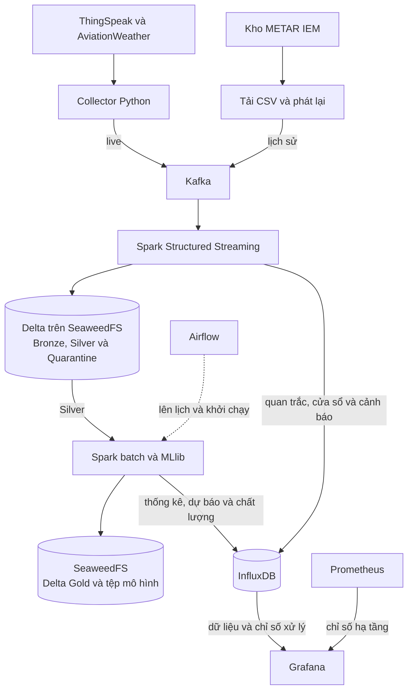
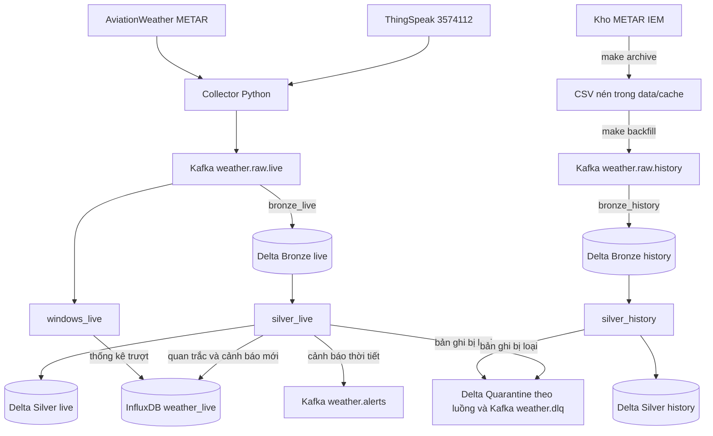
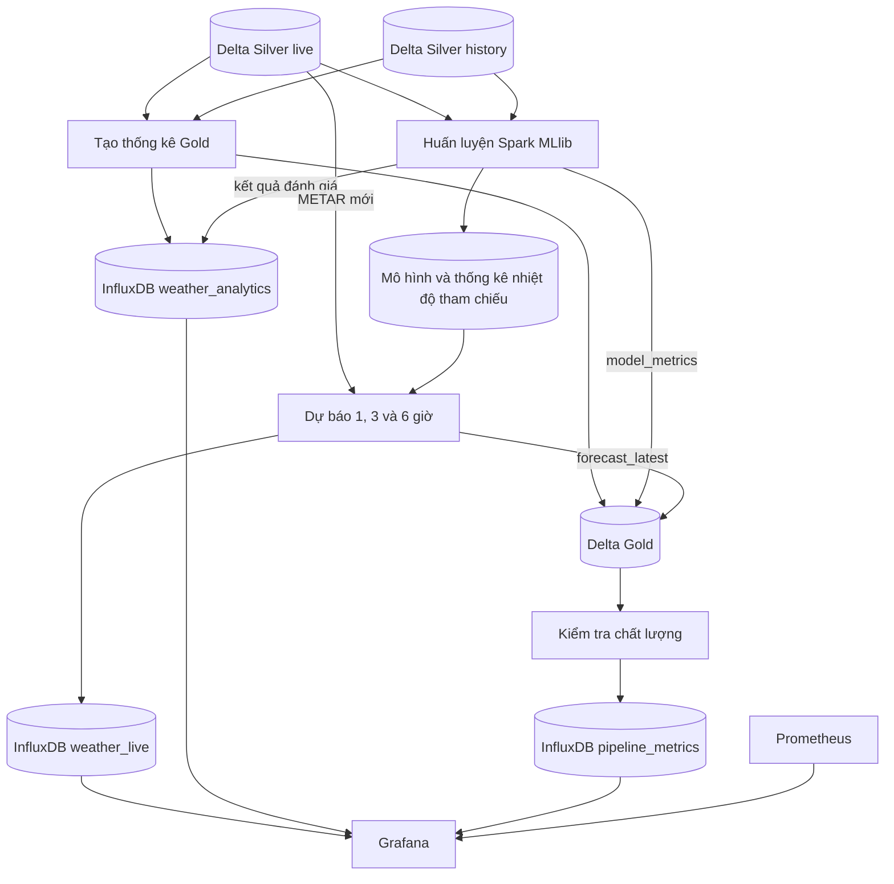
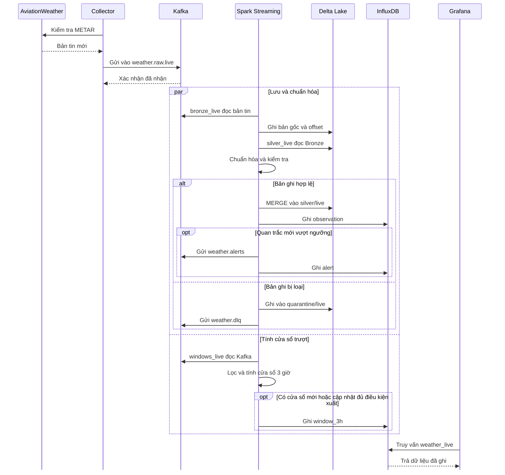

# Kiến trúc và quyết định thiết kế

## 1. Bài toán

Thu thập, làm sạch, lưu trữ, phân tích và dự báo dữ liệu thời tiết sân bay Việt Nam, gồm:

- **luồng live**: kênh IoT ThingSpeak 3574112 và METAR của 7 sân bay;
- **luồng lịch sử**: kho METAR công khai từ năm 1949, khoảng 2,4 triệu bản ghi.

Hai luồng dùng chung bộ luật chuẩn hóa và kiểm tra chất lượng. Bronze giữ các lần nhận bản tin để truy
vết. Silver hợp nhất các lần gửi lại của cùng một sự kiện.

### 1.1. Kiến trúc tổng thể

Mũi tên liền chỉ hướng dữ liệu. Mũi tên nét đứt chỉ lệnh điều phối từ Airflow. Docker Compose khởi
động các dịch vụ, kết nối chúng qua mạng nội bộ và gắn các volume lưu trữ. [Cấu hình Docker Compose](../compose.yaml)

### 1.2. Vai trò của các thành phần

| Thành phần | Mục đích | Công việc trong hệ thống |
|---|---|---|
| **Collector Python và nạp lịch sử** | Tiếp nhận dữ liệu từ các nguồn có cấu trúc khác nhau. | Collector đọc hai API live. Lệnh `make archive` tải IEM, còn `make backfill` phát lại các tệp đã tải. Cả hai luồng gửi thông điệp theo cùng một cấu trúc JSON. |
| **Apache Kafka** | Giữ luồng bản tin để thu thập và xử lý có thể chạy độc lập. | Nhận dữ liệu vào `weather.raw.live` và `weather.raw.history`. Spark có thể tiếp tục đọc từ offset đã lưu khi khởi động lại. Kafka cũng nhận bản ghi bị loại ở `weather.dlq` và cảnh báo thời tiết ở `weather.alerts`. |
| **Cụm Apache Spark** | Chạy các tác vụ xử lý dữ liệu trên nhiều executor. | Spark master cấp tài nguyên cho ứng dụng. Hai worker chạy các executor phục vụ truy vấn streaming và job batch. |
| **Spark Structured Streaming** | Xử lý dữ liệu khi bản tin đến. | Đọc Kafka, lưu Bronze, chuẩn hóa và hợp nhất bản trùng vào Silver, cách ly dòng lỗi, tính cửa sổ live và phát cảnh báo thời tiết. |
| **Spark SQL và MLlib** | Tạo thống kê lịch sử và dự báo nhiệt độ. | Job batch dùng Spark SQL và DataFrame để xây dựng Gold và kiểm tra chất lượng. MLlib huấn luyện mô hình và chạy dự báo cho từng mốc **1, 3 và 6 giờ**. |
| **Delta Lake** | Quản lý dữ liệu theo bảng có nhật ký giao dịch. | Lưu Bronze, Silver, Quarantine và Gold. Spark dùng `MERGE` để hợp nhất bản ghi Silver và có thể đọc Bronze dưới dạng luồng. |
| **SeaweedFS** | Cung cấp kho đối tượng tương thích S3 cho lakehouse. | Lưu tệp của các bảng Delta, checkpoint streaming và tệp mô hình. Spark truy cập qua `s3a://lakehouse`. |
| **InfluxDB** | Phục vụ truy vấn theo thời gian cho dashboard. | Lưu quan trắc, cảnh báo và dự báo trong `weather_live`, thống kê và kết quả đánh giá trong `weather_analytics`, cùng chỉ số xử lý trong `pipeline_metrics`. |
| **Apache Airflow** | Lên lịch và quản lý thứ tự chạy các job batch. | Khởi chạy job Spark để tạo Gold, kiểm tra dữ liệu, huấn luyện và dự báo. Airflow lưu trạng thái, log và thử lại tác vụ theo cấu hình DAG. |
| **Prometheus và Kafka exporter** | Theo dõi tình trạng hạ tầng. | Kafka exporter cung cấp chỉ số Kafka như số broker và số phân vùng thiếu bản sao. Prometheus lấy các chỉ số đó cùng chỉ số Spark master, workers, InfluxDB và SeaweedFS mỗi 15 giây. |
| **Grafana** | Hiển thị thời tiết và hỗ trợ theo dõi vận hành. | Đọc InfluxDB để hiển thị quan trắc, thống kê, dự báo và tiến độ xử lý. Đọc Prometheus để hiển thị chỉ số hạ tầng và đánh giá cảnh báo vận hành. |

Kafka UI hỗ trợ xem topic, phân vùng và nội dung thông điệp. Spark UI hỗ trợ theo dõi các truy vấn
streaming, job và executor. Các địa chỉ truy cập nằm trong [README.md](../README.md).

## 2. Luồng dữ liệu

### 2.1. Thu thập và đưa bản tin vào Kafka

| Luồng | Cách lấy dữ liệu | Đích Kafka |
|---|---|---|
| **Live – ThingSpeak** | Collector kiểm tra API mỗi **60 giây** mặc định. Bản tin mang mã `TS3574112` và dùng `created_at`, tức thời điểm ghi lên kênh, làm `event_time`. | `weather.raw.live` |
| **Live – AviationWeather** | Collector kiểm tra METAR của **7 sân bay** mỗi **120 giây** mặc định. `event_time` lấy từ `obsTime`, tức giờ quan trắc tại sân bay. | `weather.raw.live` |
| **Lịch sử – IEM** | `make archive` tải dữ liệu theo trạm và giai đoạn vào `data/cache/*.csv.gz`. `make backfill` đọc từng dòng, lấy giờ quan trắc UTC từ cột `valid`, phát lại qua Kafka và đợi Spark xử lý xong luồng lịch sử. | `weather.raw.history` |

Hai chu kỳ kiểm tra API quy định thời điểm collector hỏi nguồn về bản tin mới. Khi khởi động hoặc sau
lỗi, collector mở rộng phạm vi đọc để bù những bản tin còn lấy được từ API. Lịch sử nhiều năm được nạp
qua các tệp IEM. Danh sách sân bay và đặc điểm từng nguồn nằm trong [DATA.md](DATA.md). Mã thu thập nằm
trong [collector.py](../src/weather_pipeline/ingest/collector.py),
[sources.py](../src/weather_pipeline/ingest/sources.py) và [replay.py](../src/weather_pipeline/ingest/replay.py).

Mọi producer dùng chung [định dạng thông điệp JSON](../src/weather_pipeline/ingest/envelope.py). Kafka
dùng mã trạm làm khóa để các thông điệp của cùng trạm đi vào cùng phân vùng trong một topic. Hai topic
đầu vào có **6 phân vùng** và thời hạn lưu **30 ngày**. Các trường dùng xuyên suốt pipeline gồm:

| Trường | Ý nghĩa |
|---|---|
| `schema_version`, `source`, `station` | Phiên bản cấu trúc, nguồn dữ liệu và mã trạm. |
| `event_id` | Định danh để hợp nhất các lần nhận cùng sự kiện. METAR dùng nguồn, trạm và giờ quan trắc. ThingSpeak dùng thêm `entry_id` cùng giờ ghi lên kênh. |
| `event_time`, `ingested_at` | Thời điểm của sự kiện theo nguồn và thời điểm collector hoặc chương trình nạp lịch sử bắt đầu lần thu thập tương ứng. |
| `payload` | Các trường do bộ đọc nguồn chuyển vào thông điệp, trước khi Spark đổi kiểu và đơn vị đo. |

### 2.2. Spark lưu dữ liệu gốc, chuẩn hóa và phục vụ luồng live

Dịch vụ [Spark Structured Streaming](../src/weather_pipeline/streaming/app.py) chạy liên tục với trigger
mặc định **5 giây**. Mỗi luồng có một truy vấn Bronze và một truy vấn Silver với checkpoint riêng. Truy
vấn thứ năm, `windows_live`, xử lý thống kê cửa sổ. Các bảng Delta và checkpoint nằm trên SeaweedFS,
qua S3A. Ví dụ đường dẫn mặc định là `s3a://lakehouse/weather/bronze/live`,
`s3a://lakehouse/weather/silver/history` và `s3a://lakehouse/weather/_checkpoints/windows_live`.

1. **Kafka → Bronze.** Spark lưu nội dung thông điệp kèm `topic`, `partition`, `offset`, khóa và thời
   điểm Kafka. Tọa độ Kafka cho phép truy lại thông điệp gốc. Hai truy vấn đọc Kafka giới hạn lần lượt
   **10.000** offset mỗi micro-batch của live và **250.000** của history.
2. **Bronze → kiểm tra và chuẩn hóa.** Spark đưa các trường về cùng tên và đơn vị. Ví dụ, `field1`,
   `temp` và `tmpc` đều thành `temperature_c`. Tốc độ gió METAR từ knot được đổi sang km/h. Một giá trị
   ngoài phạm vi được đặt thành `null` kèm cờ `qc_flags`. Nếu cấu trúc hoặc thời gian sai, hoặc dòng
   thiếu toàn bộ bốn chỉ số có thể dùng gồm nhiệt độ, gió, áp suất và tầm nhìn, Spark lưu dòng vào
   Quarantine của luồng tương ứng và gửi thông tin lỗi vào `weather.dlq`.
3. **Bản ghi hợp lệ → Silver.** Spark dùng `MERGE` theo `station` và `event_id` để giữ một dòng cho mỗi
   sự kiện trong từng luồng. Bản đến sau với nội dung sửa đổi có thể cập nhật dòng đã có. Với live,
   cùng truy vấn ghi `observation` vào InfluxDB và gửi cảnh báo thời tiết vào `weather.alerts` và
   InfluxDB khi quan trắc METAR thỏa ngưỡng, chẳng hạn gió mạnh hoặc tầm nhìn thấp.
4. **Kafka live → cửa sổ trượt.** `windows_live` đọc trực tiếp `weather.raw.live` và áp dụng cùng bộ
   luật chuẩn hóa. Truy vấn tính thống kê theo trạm và nguồn trên **cửa sổ 3 giờ, bước 30 phút**, ví dụ
   nhiệt độ trung bình và gió lớn nhất, rồi ghi `window_3h` vào InfluxDB. Cửa sổ dựa trên `event_time`.
   Watermark **3 giờ** giới hạn thời gian giữ trạng thái. Bản tin đến quá muộn có thể bị bỏ qua ở nhánh
   cửa sổ và vẫn được xử lý theo quy tắc của Bronze và Silver.

Chi tiết triển khai nằm trong [transforms.py](../src/weather_pipeline/streaming/transforms.py),
[sinks.py](../src/weather_pipeline/streaming/sinks.py) và
[analytics.py](../src/weather_pipeline/streaming/analytics.py). Xem thêm
[quy tắc watermark của Spark](https://spark.apache.org/docs/4.1.0/streaming/apis-on-dataframes-and-datasets.html#semantic-guarantees-of-aggregation-with-watermarking).

### 2.3. Spark batch tạo thống kê Gold và dự báo

- **Gold.** Job đọc `Silver history` và `Silver live`, hợp nhất quan trắc sân bay theo `station` và
  `event_time`. Khi IEM và AviationWeather cùng có một quan trắc, bản AviationWeather được ưu tiên.
  ThingSpeak được đối chiếu riêng với METAR Đà Nẵng trong `reconciliation` để tránh tính lặp vào thống
  kê sân bay. Job kiểm tra giá trị bất thường theo ngữ cảnh, tạo các bảng theo giờ, ngày, tháng, năm
  và ghi các kết quả cần hiển thị sang `weather_analytics`. Sau khi Gold được ghi và xuất sang InfluxDB,
  bước `quality_gate` kiểm tra các tầng dữ liệu và ghi kết quả vào `pipeline_metrics`.
  [Job Gold](../src/weather_pipeline/batch/gold.py) ·
  [Kiểm tra chất lượng](../src/weather_pipeline/batch/checks.py)
- **Huấn luyện.** Spark MLlib đọc hai bảng Silver và hợp nhất METAR theo cùng quy tắc ưu tiên. Các đặc
  trưng gồm quan trắc đúng giờ tại thời điểm dự báo và các giờ trước đó, chu kỳ ngày và mùa, cùng mức
  nhiệt độ tham chiếu tính từ tập huấn luyện. Với mỗi mốc **1, 3 và 6 giờ**, job so sánh hồi quy tuyến
  tính với GBT trên tập validation và lưu mô hình có MAE thấp hơn.
  Lần chạy trong báo cáo chọn GBT ở cả ba mốc. [Job huấn luyện](../src/weather_pipeline/ml/train.py) ·
  [Kết quả thực nghiệm](RESULTS.md#6-dự-báo-nhiệt-độ)
- **Dự báo.** Job tải mô hình đã lưu và đọc METAR AviationWeather gần nhất từ `Silver live`. Mô hình
  ước lượng mức thay đổi nhiệt độ để cộng vào nhiệt độ hiện tại. Kết quả được ghi vào Delta
  `gold/forecast_latest` và InfluxDB `weather_live`, với mốc thời gian là thời điểm dự báo có hiệu lực.
  [Job dự báo](../src/weather_pipeline/ml/forecast.py)

[Airflow](../dags/weather_pipeline.py) điều phối các job theo lịch. DAG Gold chạy hằng ngày theo thứ
tự `build_gold` → `quality_gate`. DAG huấn luyện chạy hằng tuần theo thứ tự `train` → `forecast`.
DAG `weather_forecast` chạy riêng vào phút 10 và 40 mỗi giờ. Tác vụ lỗi được cấu hình thử lại **một lần
sau 2 phút**. Dịch vụ Spark Streaming vẫn chạy liên tục trong [Docker Compose](../compose.yaml).

### 2.4. Grafana hiển thị dữ liệu thời tiết và tình trạng hệ thống

| Nguồn Grafana đọc | Dữ liệu hiển thị |
|---|---|
| InfluxDB `weather_live` | Quan trắc mới, cảnh báo thời tiết từ Spark, thống kê cửa sổ trượt và dự báo. |
| InfluxDB `weather_analytics` | Thống kê lịch sử, xu hướng, tỷ lệ khớp giữa ThingSpeak và METAR, kết quả đánh giá mô hình. |
| InfluxDB `pipeline_metrics` | Số dòng, thời gian mỗi micro-batch, số offset Spark còn phải đọc và kết quả kiểm tra chất lượng. Spark gửi chỉ số xử lý qua `StreamingQueryListener`. |
| Prometheus | Chỉ số hạ tầng thu mỗi **15 giây** từ Kafka exporter, Spark master và workers, InfluxDB và SeaweedFS. Grafana dùng số broker Kafka để đánh giá cảnh báo vận hành. |

Xem [dashboard Grafana](../scripts/build_dashboards.py),
[cấu hình Prometheus](../docker/prometheus/prometheus.yml) và
[bộ thu chỉ số Spark](../src/weather_pipeline/streaming/monitor.py).

### 2.5. Ví dụ theo dõi một bản tin Đà Nẵng

1. **Thu thập.** Giả sử AviationWeather công bố METAR `VVDN` quan trắc lúc **10:00 UTC**, có tốc độ gió
   **25 knot**. Collector gửi bản tin vào `weather.raw.live` với khóa Kafka `VVDN`. Nếu collector đọc
   lúc **10:06 UTC**, `event_time` vẫn là 10:00 và `ingested_at` là 10:06.
2. **Xử lý live.** Bronze giữ bản tin và offset Kafka. Silver lưu gió **46,3 km/h** sau quy đổi. Giá trị
   vượt ngưỡng **39 km/h** nên Spark tạo cảnh báo `strong_wind` và gửi sang Kafka lẫn InfluxDB. Nhánh
   cửa sổ trượt có thể dùng quan trắc này để cập nhật giá trị gió lớn nhất. Grafana đọc kết quả từ InfluxDB.
3. **Dự báo.** Nếu quan trắc lúc 10:00 là bản tin đủ đặc trưng mới nhất, job dự báo dùng nó cùng quan
   trắc trước đó của `VVDN` để dự báo nhiệt độ vào **11:00, 13:00 và 16:00 UTC**.
4. **Hợp nhất lịch sử.** Nếu bản tin cùng trạm và cùng giờ xuất hiện trong lần nạp IEM sau đó, nó đi qua
   Bronze và Silver của luồng lịch sử. Khi tính lại Gold, Spark giữ một quan trắc `VVDN` lúc 10:00,
   ưu tiên bản AviationWeather. Nếu ThingSpeak đăng lại các chỉ số lúc **10:17 UTC**, bản ghi mang mã
   `TS3574112` và được ghép với METAR 10:00 trong bảng đối chiếu theo quy tắc mô tả ở [DATA.md](DATA.md#3-phát-hiện-và-cách-xử-lý).

### 2.6. Sơ đồ trình tự xử lý một bản tin live

Sơ đồ theo dõi một bản tin METAR mới. Hai nhánh trong khối **song song** có checkpoint riêng và có thể
ghi kết quả vào InfluxDB ở những thời điểm khác nhau.

Với IEM, dữ liệu lịch sử đi theo các truy vấn `bronze_history` và `silver_history`. Airflow khởi chạy
các job Spark đọc dữ liệu Silver theo lịch mô tả ở [mục 2.3](#23-spark-batch-tạo-thống-kê-gold-và-dự-báo).

Kiến trúc **lai** dùng cách phát lại dữ liệu của Kappa để luồng live và lịch sử chia sẻ cùng bộ luật
làm sạch. Gold và huấn luyện chạy theo lô để tổng hợp và học từ dữ liệu nhiều năm.

## 3. Các tầng dữ liệu

| Tầng | Nội dung | Khóa | Phân vùng | Cách ghi |
|---|---|---|---|---|
| Bronze | message nguyên bản và tọa độ Kafka | topic, partition, offset | `ingest_date` | append, checkpoint |
| Silver | một schema, một hệ đơn vị, cờ QC | station, event_id | `station` | `MERGE` |
| Quarantine | bản ghi bị loại và lý do | topic, partition, offset | `reject_reason` | append với `txnAppId`, `txnVersion` |
| Gold | observations, hourly, daily, monthly, annual, trends, climatology, quality, reconciliation | tùy bảng | `station` (bảng lớn) | overwrite nguyên tử |
| Serving | InfluxDB: `weather_live` (90 ngày), `weather_analytics` (200 năm), `pipeline_metrics` (14 ngày) | measurement, tags, time | shard theo thời gian | ghi đè theo khóa |

## 4. Lựa chọn công nghệ

| Vai trò | Chọn | Lý do | Phương án không chọn |
|---|---|---|---|
| Message bus | Kafka KRaft, 3 broker | RF=3, min ISR=2, phát lại được | MQTT: hợp với thiết bị nhưng không có log để phát lại. 1 broker: không minh họa được chịu lỗi |
| Xử lý | Spark 4.1 | một engine cho stream, batch và ML | Flink: độ trễ thấp hơn, nhưng nguồn cập nhật 30 phút/lần và vẫn cần thêm engine cho ML |
| Table format | Delta Lake 4.4 | ACID, MERGE, đọc được như stream | Parquet thuần: không có MERGE và commit nguyên tử. Iceberg: tốt nhưng cần thêm catalog |
| Object storage | SeaweedFS | tương thích S3, nhẹ | MinIO: không còn image chính thức trên Docker Hub. HDFS: nặng trên một máy |
| Serving | InfluxDB 2.9 | chuỗi thời gian, Flux, tích hợp Grafana | InfluxDB 3 Core: thiết kế cho dữ liệu gần, không hợp truy vấn 70 năm. Cassandra: yếu về truy vấn tổng hợp |
| Trực quan | Grafana | cấu hình bằng file, có alert | Superset: mạnh về BI, kém về giám sát realtime |
| Điều phối | Airflow 3 | DAG, retry, lịch sử chạy | cron: không có phụ thuộc giữa các task |
| ML | Spark MLlib | huấn luyện phân tán ngay trên lakehouse | scikit-learn: phải kéo dữ liệu về một máy |
| Giám sát | Prometheus, kafka-exporter, StreamingQueryListener | thấy cả hạ tầng lẫn từng micro-batch | chỉ xem log |

## 5. Đảm bảo khi có lỗi

| Đoạn | Mức đảm bảo | Cơ chế |
|---|---|---|
| API → Kafka | at-least-once | chỉ ghi nhớ bản ghi sau khi được ack, đọc bù khi khởi động hoặc sau lỗi |
| Producer → broker | không trùng trong một phiên producer | idempotence, `acks=all` |
| Kafka → Bronze | exactly-once | checkpoint và transaction log của Delta |
| Bronze → Silver | effectively-once | `MERGE` theo event_id |
| Bronze → Quarantine | exactly-once | transaction id theo query và batch của truy vấn Silver |
| → DLQ, alerts | **at-least-once** | consumer cần khử trùng theo event_id hoặc offset |
| → InfluxDB | effectively-once | cùng tags và timestamp thì ghi đè. Gold xóa measurement trước khi publish lại. Live: field bị bỏ trong METAR đính chính vẫn giữ giá trị cũ |

Khi collector khởi động lại, nó gửi lại dữ liệu đọc bù. Bronze lưu các bản sao này (đúng vai trò log
thô), Silver hợp nhất chúng.

Phát lại cùng bộ tệp bằng `make backfill` sẽ thêm các thông điệp có offset mới vào Bronze. Silver giữ
một dòng cho mỗi sự kiện theo quy tắc `MERGE`.

Phép thử thực nghiệm: `make e2e`, kết quả ở [RESULTS.md](RESULTS.md).

## 6. Các khái niệm xử lý stream

- **Thời gian sự kiện và watermark** được áp dụng ở nhánh cửa sổ theo [mục 2.2](#22-spark-lưu-dữ-liệu-gốc-chuẩn-hóa-và-phục-vụ-luồng-live).
  Spark dùng `min`, `max` và tập các cặp `(event_time, temperature_c)` để một bản tin giống hệt được
  gửi lại chỉ đóng góp một mẫu vào thống kê nhiệt độ của cửa sổ.
- **RocksDB** giữ trạng thái của truy vấn cửa sổ. Checkpoint trên SeaweedFS qua S3A lưu tiến độ để truy
  vấn có thể tiếp tục sau khi khởi động lại.
- **Live và history** dùng topic, truy vấn và bảng riêng, đồng thời chia sẻ tài nguyên cụm Spark.
- **Một driver ghi cho mỗi bảng**: Delta trên S3 thường chỉ an toàn commit trong một driver. Streaming
  là writer duy nhất của Bronze, Silver, Quarantine. Không chạy `make gold` hoặc `make train` đúng lúc
  DAG tương ứng đang chạy.

## 7. Phân bổ tài nguyên

Cụm Spark có 2 worker, tổng 8 core và 8 GB:

- streaming giữ 4 core;
- job batch dùng tối đa 4 core, Airflow chạy tuần tự (`parallelism=1`);
- `make bench` tạm dừng streaming, `make e2e` tạm dừng Airflow.

## 8. Giới hạn và hướng lên production

- Mọi thứ chạy trên **một máy**: chịu được lỗi process và container, không chịu được hỏng máy hay ổ đĩa.
- Spark master, SeaweedFS và InfluxDB là điểm lỗi đơn.
- Trong mạng Docker, Kafka và Spark RPC chưa có TLS/SASL. Các UI chỉ bind `127.0.0.1`.
- InfluxDB dùng chung admin token. Production cần token riêng theo quyền đọc, ghi.
- Airflow `standalone` với SQLite chỉ phù hợp demo. Production cần PostgreSQL.
- Chưa có Schema Registry: hợp đồng message được giữ bằng `schema_version`, Spark kiểm tra và cách ly.
- Gold được tính lại toàn bộ mỗi ngày. Ở quy mô lớn hơn nhiều cần tính tăng dần theo phân vùng.
